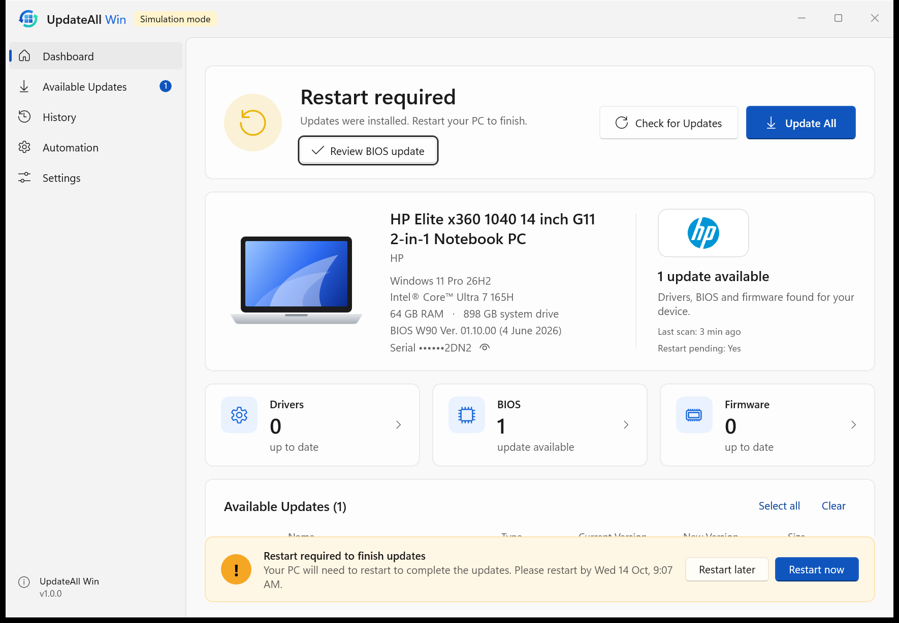

# UpdateAll Win

**One app. Every driver. Always up to date.**

UpdateAll Win is a native Windows 11 app that keeps a PC's **drivers, BIOS and firmware** current. It
works out who made the PC and drives that manufacturer's official update tool. The core feature is a
small floating **Update All** toolbar: one click checks the PC and installs everything that's safe to
install. Nothing else needs choosing.



## What's in the box

| Part | What it does |
|---|---|
| **UpdateAll Win app** (WinUI 3) | The Dashboard, Available Updates, History, Automation and Settings pages. Fluent design, light and dark themes, your logo. |
| **Floating toolbar** | A draggable, always-on-top **Update All** button. It shows status with a coloured dot: 🟢 up to date · 🔵 working · 🟠 updates available · 🔴 failed · 🟡 restart required. Right-click for more options. |
| **Notification-area icon** | The same status colours and menu, available whenever you're signed in. |
| **Windows notifications** | *Restart required*, with **Restart Now / Restart Later / Open UpdateAll Win**. Also BIOS approval requests, failures, and updates found by a scheduled scan. |
| **UpdateAllService** | A LocalSystem Windows service that does all the privileged work: scheduled scans, downloads and installs. It keeps working when the app is closed. |
| **Command line** | `UpdateAllService.exe status \| scan \| update-all \| history \| export-diagnostics` for Intune, RMM and scripts, with standard exit codes. |
| **MSI installer** | Installs everything and registers the service, shortcuts and the sign-in agent. Uninstalls cleanly. |

## Manufacturer support

| Manufacturer | Tool used | How updates install | Status |
|---|---|---|---|
| **HP** | HP Image Assistant (downloaded automatically from HP and verified as signed by HP Inc.) | Per SoftPaq (`/SPList`) | Scan verified on an HP Elite x360 1040 G11 (HPIA 5.3.7 downloaded, signature checked, 3 updates found). **Installs not yet run on hardware** (see *Testing*). |
| **Dell** | Dell Command \| Update CLI (installed with winget if missing) | Per category (DCU filters by type, not by single update) | Written to Dell's 5.x CLI reference. **Not tested on Dell hardware.** |
| **Lenovo** | Commercial Vantage + SU Helper if present, otherwise Lenovo System Update | SU Helper: per category, plus approved BIOS by package ID. System Update: one combined run (it has no silent list mode). | Written to Lenovo CDRT docs. **Not tested on Lenovo hardware.** |
| **Everyone else** (ASUS, Acer, MSI, Surface…) | Windows Update driver and firmware updates | Per update | Uses the documented Windows Update Agent API. |

Every switch and exit code is checked against the vendor's documentation, with sources and confidence
levels in [`docs/vendor-cli-reference.md`](docs/vendor-cli-reference.md). Each adapter declares what it
can really do (for example `InstallByCategory`, `InstallAllOnly` or `HandlesBitLockerForBios`), and the
engine works within those limits.

## Safety

* **Update All never bypasses BIOS approval.** BIOS updates wait for an explicit approval dialog unless an
  administrator turns that off in policy. If a vendor tool can only install everything together, the
  engine won't run it while one of its BIOS updates is unapproved or excluded.
* Before any BIOS update, these are checked:
  * the manufacturer and model are confirmed by the vendor's own tool
  * the vendor tool verifies the package
  * the PC is on **AC power**
  * the **battery** is at or above the policy minimum (default 50%)
  * **BitLocker** is checked: it's blocked if there's no recovery key, and suspended for one restart when policy allows
  * there's enough **disk space**
* While BIOS is flashing, a shutdown block reason is set and sleep is prevented.
* A System Restore point is created before installs (policy setting).
* **It never restarts automatically.** Restart reminders follow the deferral policy, and "Restart later"
  stops being offered once the deferral period ends.
* The UI runs without admin rights. The service accepts only a fixed set of named requests over a named
  pipe with an ACL: there is no "run this command" request. Changing policy needs an elevated
  administrator, checked from the caller's process token. Tool paths must sit under Program Files.
  The data folder is locked down to SYSTEM and Administrators.

## Architecture

```
UpdateAllWin.slnx
├─ src/UpdateAllWin.Contracts           IPC protocol, DTOs, MachinePolicy (net10.0)
├─ src/UpdateAllWin.Core                Engine, safety checks, scheduling, SQLite history, logging
├─ src/UpdateAllWin.ManufacturerAdapters HP · Dell · Lenovo · Windows Update · Simulated
├─ src/UpdateAllWin.Service             UpdateAllService (Windows service) + command line
├─ src/UpdateAllWin.Toolbar             Floating toolbar, tray icon, notifications, status monitor
├─ src/UpdateAllWin.App                 WinUI 3 app (UpdateAllWin.exe)
├─ src/UpdateAllWin.Installer           WiX 5 MSI
└─ tests/UpdateAllWin.Tests             58 unit + integration tests (mock adapters, real pipes and SQLite)
```

To add a manufacturer, implement `IManufacturerAdapter` and register it in
`AdapterServiceCollectionExtensions`. The engine needs no changes.

Data lives in `%ProgramData%\UpdateAllWin`:

* `policy.json`
* `updateall.db` (history and state)
* `Logs\`
* `Work\` (vendor reports)
* `Downloads\`

Per-user preferences are in `%LocalAppData%\UpdateAllWin\preferences.json`.

### Taskbar integration

Windows 11 has **no supported way** to embed a toolbar in the taskbar (deskbands were removed and
Explorer injection isn't acceptable). UpdateAll Win uses the supported options instead: the floating
toolbar, the notification-area icon, notifications, and Start menu / desktop **Update All** shortcuts.

## Building

Requires Windows, the .NET 10 SDK and PowerShell.

```powershell
./build/build.ps1                                  # tests → publish → MSI
./build/build.ps1 -CertificateThumbprint <sha1>    # also Authenticode-signs exes, DLLs and the MSI
```

Output goes to `artifacts\installer\UpdateAllWin-1.0.0-x64.msi`. You can also develop from WSL:
`build/wsl-build.sh` mirrors the repo to the Windows side and runs `dotnet` there.

**Try it without touching real firmware:** set `"simulationMode": true` in
`%ProgramData%\UpdateAllWin\policy.json`, or use **Settings → Simulation mode**. Then pick a scenario:
updates available, up to date, download failure, install failure or no network.

## Command line

```
UpdateAllService.exe update-all [--approve-bios] [--restart] [--json]
UpdateAllService.exe scan | status | history [--limit N] | export-diagnostics
```

Exit codes: `0` OK / up to date · `1` failures · `2` busy · `3` access denied · `4` error ·
`5` BIOS awaiting approval · `3010` restart required.

## Testing

See [`docs/testing.md`](docs/testing.md) for what has been verified and how, and what still needs testing
on real Dell and Lenovo hardware.

## Trademarks

HP, Dell, Lenovo, ASUS, Acer, MSI and Microsoft names and logos are trademarks of their respective
owners. They are used only to identify the PC's manufacturer and the manufacturer's own update tools.
Check each brand's guidelines before distributing.
